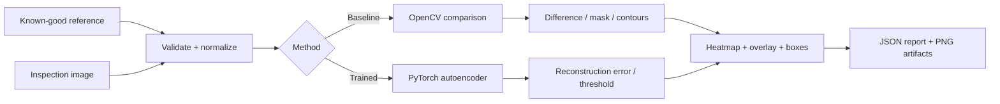

<div align="center">

# ◈ VERITYAGENT · AI DEFECT DETECTOR
### Project 09 · Python AI Mini Projects

**Reference-image inspection + PyTorch reconstruction anomaly detection**

<p>
  
  
  
  
</p>

</div>

<!--
  VERITYAGENT README VISUAL SYSTEM
  GitHub sanitizes some CSS selectors, so the primary layout intentionally uses
  semantic HTML + inline CSS while this repository also keeps the complete
  poster source at docs/visuals/defect-detector-poster.html.
-->

<div style="background:linear-gradient(135deg,#080b10,#0d141d);border:1px solid #263444;border-radius:22px;padding:28px;color:#f4f7fb;">

<div style="display:flex;justify-content:space-between;gap:20px;align-items:flex-start;">
<div>
<div style="font-size:12px;letter-spacing:3px;color:#74e7ff;font-weight:700;">VERITYAGENT · INDUSTRIAL COMPUTER VISION</div>
<h2 style="font-size:36px;margin:8px 0 6px;color:#f4f7fb;">See the defect. Measure the difference. Explain the result.</h2>
<p style="color:#93a0b3;margin:0;max-width:900px;line-height:1.7;">An engineering-focused inspection system that starts with deterministic OpenCV reference comparison and extends to a trained PyTorch convolutional autoencoder for reconstruction-based anomaly detection.</p>
</div>
<div style="border:1px solid #314052;border-radius:999px;padding:9px 14px;font-size:11px;letter-spacing:1px;color:#cbd5e1;white-space:nowrap;">PROJECT 09</div>
</div>

<div style="margin-top:24px;border:1px solid #293847;border-radius:16px;overflow:hidden;background:#070b10;">

</div>

<p style="font-size:12px;color:#718096;margin:12px 4px 0;">The poster above is generated from the repository's HTML/CSS visual system and uses evidence from the executable synthetic run. It is evidence of the implemented pipeline, not a real-world accuracy benchmark.</p>

</div>

## Why this project is different

<table>
<tr>
<td width="33%" valign="top">

### 01 · Baseline first

The OpenCV comparison pipeline works **without a trained model**. It validates the inspection workflow before introducing machine learning.

</td>
<td width="33%" valign="top">

### 02 · Model second

A PyTorch convolutional autoencoder learns normal appearance from **defect-free images** and uses reconstruction error to surface anomalies.

</td>
<td width="33%" valign="top">

### 03 · Evidence always

Every inspection can produce an annotated image, difference map, binary mask, heatmap, overlay and machine-readable JSON report.

</td>
</tr>
</table>

## Inspection pipeline



<div style="display:grid;grid-template-columns:repeat(2,minmax(0,1fr));gap:16px;">
<div style="border:1px solid #293847;border-radius:16px;padding:20px;background:#0d131b;">
<strong style="color:#74e7ff;">OpenCV reference comparison</strong>
<p style="color:#93a0b3;line-height:1.7;">Validates images, handles compatible dimensions, optionally aligns small camera shifts, compensates for robust global illumination offset, computes absolute differences, thresholds candidate pixels, performs morphology, extracts contours and produces explainable visual evidence.</p>
</div>
<div style="border:1px solid #293847;border-radius:16px;padding:20px;background:#0d131b;">
<strong style="color:#74e7ff;">PyTorch reconstruction anomaly detection</strong>
<p style="color:#93a0b3;line-height:1.7;">Trains only on normal images, stores a state-dict checkpoint plus preprocessing metadata, estimates a pixel threshold from held-out normal validation data, and generates reconstruction-error regions at inference time.</p>
</div>
</div>

## Actual demo evidence

The included deterministic synthetic run detected one candidate region in a 640×480 image. These values are read from the generated `report.json` rather than invented for the README.

<table>
<tr><th>Metric</th><th>Observed demo value</th><th>Definition</th></tr>
<tr><td>Detected regions</td><td><strong>1</strong></td><td>Candidate contour retained after minimum-area filtering</td></tr>
<tr><td>Affected pixels</td><td><strong>0.2965%</strong></td><td>911 retained pixels / 640×480 frame</td></tr>
<tr><td>Processing time</td><td><strong>34.8 ms</strong></td><td>Measured during the included OpenCV run</td></tr>
<tr><td>Anomaly score</td><td><strong>0.001602</strong></td><td>Mean absolute pixel difference ÷ 255; not a probability</td></tr>
</table>

### Visual result set


<div style="display:flex;gap:10px;flex-wrap:wrap;margin-top:12px;">
<span style="display:inline-block;border:1px solid #293847;border-radius:999px;padding:7px 12px;color:#74e7ff;background:#0b1017;font-size:12px;">REFERENCE</span>
<span style="display:inline-block;border:1px solid #293847;border-radius:999px;padding:7px 12px;color:#74e7ff;background:#0b1017;font-size:12px;">DETECTION</span>
<span style="display:inline-block;border:1px solid #293847;border-radius:999px;padding:7px 12px;color:#74e7ff;background:#0b1017;font-size:12px;">DIFFERENCE MAP</span>
<span style="display:inline-block;border:1px solid #293847;border-radius:999px;padding:7px 12px;color:#74e7ff;background:#0b1017;font-size:12px;">HEATMAP</span>
<span style="display:inline-block;border:1px solid #293847;border-radius:999px;padding:7px 12px;color:#74e7ff;background:#0b1017;font-size:12px;">OVERLAY</span>
</div>

## HTML/CSS visual design system

The README itself uses **GitHub-safe HTML with inline CSS** for the hero panel, evidence cards, metric table, badges, and image framing. The poster source is also maintained as editable HTML/CSS at [`docs/visuals/defect-detector-poster.html`](docs/visuals/defect-detector-poster.html), with a matching SVG poster asset for GitHub rendering.

```html
<section style="background:linear-gradient(135deg,#080b10,#0d141d);border:1px solid #263444;border-radius:22px;padding:28px;color:#f4f7fb;">
  <div style="font-size:12px;letter-spacing:3px;color:#74e7ff;font-weight:700;">VERITYAGENT · INDUSTRIAL COMPUTER VISION</div>
  <h2 style="font-size:36px;margin:8px 0;color:#f4f7fb;">AI DEFECT DETECTOR</h2>
  <p style="color:#93a0b3;line-height:1.7;">Reference comparison + PyTorch reconstruction anomaly detection.</p>
  
</section>
```

This is intentionally not a generic screenshot: the poster combines the **Python/OpenCV implementation, executed synthetic inspection evidence, heatmap/difference evidence, detected-region geometry, and measured run telemetry** into one technical infographic.

## Full comparison code used by the visual

The poster's code panel is based on the real implementation. The complete implementation remains in [`src/verityagent_defect_detector/comparison.py`](src/verityagent_defect_detector/comparison.py); the excerpt below shows the complete core contour-detection stage used to convert pixel differences into candidate regions.

```python
import cv2
import numpy as np


def detect_candidate_regions(
    difference_map: np.ndarray,
    threshold: int = 22,
    min_area: float = 30.0,
) -> tuple[np.ndarray, list[dict[str, int | float]]]:
    """Threshold a difference map and return filtered candidate regions."""
    if difference_map.ndim != 2:
        raise ValueError("difference_map must be a 2D grayscale array")
    if not 0 <= threshold <= 255:
        raise ValueError("threshold must be between 0 and 255")
    if min_area <= 0:
        raise ValueError("min_area must be positive")

    mask = (difference_map >= threshold).astype(np.uint8) * 255
    kernel = np.ones((3, 3), dtype=np.uint8)
    mask = cv2.morphologyEx(mask, cv2.MORPH_OPEN, kernel)

    contours, _ = cv2.findContours(
        mask, cv2.RETR_EXTERNAL, cv2.CHAIN_APPROX_SIMPLE
    )

    regions: list[dict[str, int | float]] = []
    for contour in contours:
        area = float(cv2.contourArea(contour))
        if area < min_area:
            continue

        x, y, width, height = cv2.boundingRect(contour)
        regions.append(
            {
                "x": x,
                "y": y,
                "width": width,
                "height": height,
                "area_pixels": int(round(area)),
            }
        )

    return mask, regions
```

> **Engineering note:** The normalized anomaly score is an image-difference statistic, not a calibrated confidence or probability. A candidate region is evidence for review, not an automatic production accept/reject decision.

## Features

- Image validation for supported raster formats, file size, dimensions and channels.
- Aspect-ratio-safe handling of differently sized inputs.
- Grayscale and color comparison.
- Robust global median illumination-offset compensation.
- Optional ECC affine registration for small camera shifts.
- Configurable threshold, Gaussian blur and minimum contour area.
- Difference map, binary mask, anomaly heatmap, overlay and annotated output.
- Structured JSON reporting with coordinates, pixel areas, score definitions and processing metadata.
- PyTorch convolutional autoencoder with reproducible training.
- Normal-only train/validation pipeline and percentile threshold estimation.
- Strict checkpoint validation and CPU-first inference.
- Streamlit inspection dashboard.
- CLI for comparison, training, inference and evaluation.
- Deterministic synthetic demo generator.
- Automated tests and GitHub Actions CI.

## Repository structure

```text
verityagent-ai-defect-detector/
├── .github/workflows/ci.yml
├── .streamlit/config.toml
├── app.py
├── docs/
│   ├── ARCHITECTURE.md
│   ├── DATASET_GUIDE.md
│   ├── TROUBLESHOOTING.md
│   └── visuals/
│       ├── defect-detector-poster.html
│       └── defect-detector-poster.svg
├── examples/
│   ├── demo_data/
│   └── results/
├── scripts/
│   ├── create_demo_data.py
│   ├── evaluate_model.py
│   └── train_model.py
├── src/verityagent_defect_detector/
│   ├── alignment.py
│   ├── anomaly_model.py
│   ├── cli.py
│   ├── comparison.py
│   ├── config.py
│   ├── image_io.py
│   ├── inference.py
│   ├── reporting.py
│   ├── training.py
│   └── visualization.py
├── tests/
├── CONTRIBUTING.md
├── LICENSE
├── README.md
├── VERIFICATION.md
├── pyproject.toml
└── requirements.txt
```

## Installation

Python **3.11, 3.12 and 3.13** are supported by the project configuration.

### Windows PowerShell

```powershell
py -3.11 -m venv .venv
.\.venv\Scripts\Activate.ps1
python -m pip install --upgrade pip
python -m pip install -e ".[app,dev]"
```

### Linux / macOS

```bash
python3.11 -m venv .venv
source .venv/bin/activate
python -m pip install --upgrade pip
python -m pip install -e ".[app,dev]"
```

For library + CLI only:

```bash
python -m pip install -e .
```

## Demo without a trained model

Generate deterministic synthetic inspection data:

```bash
python scripts/create_demo_data.py --output-dir outputs/synthetic-demo-data
```

Then run the OpenCV baseline:

```bash
verity-defect compare \
  --reference examples/demo_data/reference_synthetic.png \
  --inspection examples/demo_data/inspection_scratch_synthetic.png \
  --output-dir outputs/synthetic-scratch-run \
  --threshold 22 --blur-kernel 3 --min-area 30
```

The command creates `report.json`, `difference_map.png`, `binary_mask.png`, `anomaly_heatmap.png`, `overlay.png`, `annotated_inspection.png` and the copied inputs.

## Streamlit dashboard

```bash
streamlit run app.py
```

The dashboard supports reference comparison and trained-model inference, parameter controls, result visualizations and JSON report download. It explicitly reports when a trained checkpoint is unavailable.

## Train the PyTorch model

Use defect-free images only for training and threshold calibration:

```text
data/
├── train/
│   └── good/
├── validation/
│   └── good/
└── test/
    ├── good/
    └── defective/
```

```bash
python scripts/train_model.py \
  --train-dir data/train/good \
  --validation-dir data/validation/good \
  --output models/defect_autoencoder.pt \
  --epochs 20 --batch-size 8 --image-size 256 --device cpu
```

The checkpoint stores the model `state_dict`, model configuration, preprocessing metadata and the threshold estimated from normal validation pixels. Training history is stored alongside the checkpoint.

## Trained-model inference

```bash
verity-defect infer \
  --checkpoint models/defect_autoencoder.pt \
  --inspection path/to/product.png \
  --output-dir outputs/model-inspection \
  --device cpu
```

## Evaluation

```bash
python scripts/evaluate_model.py \
  --checkpoint models/defect_autoencoder.pt \
  --test-dir data/test \
  --image-anomaly-ratio 0.005 \
  --output outputs/evaluation.json
```

Evaluation reports image-level accuracy, precision, recall and F1 for the supplied labeled test set. These metrics describe only that dataset.

## Tests and quality checks

```bash
pytest
ruff check .
python -m compileall -q src scripts app.py
```

The test suite uses deterministic synthetic arrays and temporary files. It does not download external datasets or pretrained weights.

## Documentation

- [Architecture](docs/ARCHITECTURE.md)
- [Dataset guide](docs/DATASET_GUIDE.md)
- [Troubleshooting](docs/TROUBLESHOOTING.md)
- [Verification record](VERIFICATION.md)
- [Poster HTML/CSS source](docs/visuals/defect-detector-poster.html)

## Limitations

- Pixel comparison can react to lighting, exposure, focus, orientation, camera position and harmless product variation.
- ECC alignment is intended for small affine shifts and can fail on low-texture or substantially different images.
- The autoencoder can miss defects or highlight acceptable variation when the normal training distribution is incomplete.
- A threshold calibrated only on normal validation data does not establish defect-detection accuracy.
- Synthetic demo results validate implementation and localization plumbing, not industrial performance.
- The project does not provide regulatory certification or guaranteed automated accept/reject decisions.

## Roadmap

- Product-specific labeled datasets and calibrated evaluation protocols.
- More robust registration and illumination normalization for fixed inspection rigs.
- Pixel-level segmentation metrics when ground-truth masks are available.
- Batch inspection and integrations with explicit privacy, retention and failure handling.

## License

MIT. Dataset and image rights remain with their respective owners.

<div align="center" style="margin-top:32px;padding:20px;border-top:1px solid #263444;color:#718096;">
<strong style="color:#cbd5e1;">VERITYAGENT</strong> · AI-assisted visual inspection · Project 09
</div>
