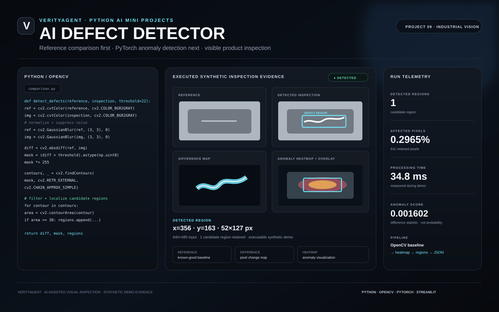
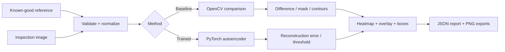

<div align="center">

# ◈ VERITYAGENT · AI DEFECT DETECTOR
### Project 09 · Python AI Mini Projects

**Reference-image inspection + PyTorch reconstruction anomaly detection**

<p></p>

</div>

<div style="background:linear-gradient(135deg,#080b10,#0d141d);border:1px solid #263444;border-radius:22px;padding:28px;color:#f4f7fb;">
<div style="font-size:12px;letter-spacing:3px;color:#74e7ff;font-weight:700;">VERITYAGENT · INDUSTRIAL COMPUTER VISION</div>
<h2 style="font-size:36px;margin:8px 0 6px;color:#f4f7fb;">See the defect. Measure the difference. Explain the result.</h2>
<p style="color:#93a0b3;line-height:1.7;">An engineering-focused inspection system that starts with deterministic OpenCV reference comparison and extends to a trained PyTorch convolutional autoencoder for reconstruction-based anomaly detection.</p>
<div style="margin-top:24px;border:1px solid #293847;border-radius:16px;overflow:hidden;background:#070b10;"></div>
<p style="font-size:12px;color:#718096;">The infographic is based on the executable synthetic inspection run. It is implementation evidence, not a real-world accuracy benchmark.</p>
</div>

## What it does

<table><tr><td width="33%" valign="top"><strong style="color:#74e7ff;">01 · OpenCV baseline</strong><br><br>Works without a trained model. Compares a known-good reference with an inspection image, finds candidate differences and localizes them with bounding boxes.</td><td width="33%" valign="top"><strong style="color:#74e7ff;">02 · PyTorch model</strong><br><br>Trains a convolutional autoencoder on defect-free images and uses reconstruction error to surface unusual regions.</td><td width="33%" valign="top"><strong style="color:#74e7ff;">03 · Evidence</strong><br><br>Exports difference maps, masks, heatmaps, overlays, annotated images and machine-readable JSON reports.</td></tr></table>

## Inspection architecture



## Executed demo evidence

The included deterministic synthetic run produced these actual values:

| Metric | Observed | Meaning |
|---|---:|---|
| Candidate regions | **1** | Retained contour after minimum-area filtering |
| Affected pixels | **0.2965%** | 911 retained pixels in a 640×480 frame |
| Processing time | **34.8 ms** | Measured during the included run |
| Anomaly score | **0.001602** | Mean absolute pixel difference ÷ 255; **not a probability** |

The defect coordinates in the executed report are **x=356, y=163, width=52, height=127 px**.

## Full comparison code used by the visual

The complete implementation is in [`src/verityagent_defect_detector/comparison.py`](src/verityagent_defect_detector/comparison.py). This is the complete core stage that turns a pixel difference map into candidate regions:

```python
import cv2
import numpy as np


def detect_candidate_regions(
    difference_map: np.ndarray,
    threshold: int = 22,
    min_area: float = 30.0,
) -> tuple[np.ndarray, list[dict[str, int | float]]]:
    if difference_map.ndim != 2:
        raise ValueError("difference_map must be a 2D grayscale array")
    if not 0 <= threshold <= 255:
        raise ValueError("threshold must be between 0 and 255")
    if min_area <= 0:
        raise ValueError("min_area must be positive")

    mask = (difference_map >= threshold).astype(np.uint8) * 255
    kernel = np.ones((3, 3), dtype=np.uint8)
    mask = cv2.morphologyEx(mask, cv2.MORPH_OPEN, kernel)

    contours, _ = cv2.findContours(
        mask, cv2.RETR_EXTERNAL, cv2.CHAIN_APPROX_SIMPLE
    )

    regions = []
    for contour in contours:
        area = float(cv2.contourArea(contour))
        if area < min_area:
            continue
        x, y, width, height = cv2.boundingRect(contour)
        regions.append({
            "x": x,
            "y": y,
            "width": width,
            "height": height,
            "area_pixels": int(round(area)),
        })

    return mask, regions
```

> **Important:** Pixel differences can be caused by lighting, focus, alignment or normal product variation. Candidate regions require validation and human review before operational decisions.

## Features

- Safe image validation and decoding.
- Aspect-ratio-safe reference/inspection handling.
- Grayscale or color comparison.
- Global illumination-offset normalization.
- Optional ECC affine alignment.
- Thresholding + morphology + contour extraction.
- Difference map, binary mask, heatmap, overlay and annotated output.
- JSON report with definitions, coordinates, pixel areas and runtime.
- PyTorch convolutional autoencoder.
- Normal-only training and validation threshold estimation.
- Strict state-dict checkpoint validation.
- CPU-first inference with optional CUDA.
- Premium Streamlit dashboard with HTML/CSS styling.
- CLI for compare, train, infer and evaluate workflows.
- Deterministic synthetic demo generation.
- 31-test automated suite + GitHub Actions CI.

## Repository structure

```text
verityagent-ai-defect-detector/
├── .github/workflows/ci.yml
├── .streamlit/config.toml
├── app.py
├── docs/
│   ├── ARCHITECTURE.md
│   ├── DATASET_GUIDE.md
│   ├── TROUBLESHOOTING.md
│   └── visuals/
│       ├── defect-detector-poster.html
│       └── defect-detector-poster.svg
├── examples/demo_data/
├── scripts/
│   ├── create_demo_data.py
│   ├── evaluate_model.py
│   └── train_model.py
├── src/verityagent_defect_detector/
├── tests/
├── CONTRIBUTING.md
├── LICENSE
├── README.md
├── VERIFICATION.md
├── pyproject.toml
└── requirements.txt
```

## Installation

Python **3.11, 3.12 and 3.13** are supported.

```bash
python3.11 -m venv .venv
source .venv/bin/activate
python -m pip install --upgrade pip
python -m pip install -e ".[app,dev]"
```

Windows PowerShell:

```powershell
py -3.11 -m venv .venv
.\.venv\Scripts\Activate.ps1
python -m pip install -e ".[app,dev]"
```

## Demo without a trained model

```bash
python scripts/create_demo_data.py --output-dir outputs/synthetic-demo-data
verity-defect compare \
  --reference examples/demo_data/reference_synthetic.png \
  --inspection examples/demo_data/inspection_scratch_synthetic.png \
  --output-dir outputs/synthetic-scratch-run \
  --threshold 22 --blur-kernel 3 --min-area 30
```

The output includes `report.json`, `difference_map.png`, `binary_mask.png`, `anomaly_heatmap.png`, `overlay.png` and `annotated_inspection.png`.

## Streamlit dashboard

```bash
streamlit run app.py
```

The dashboard supports reference comparison and trained-model inference, adjustable parameters, result visualization and JSON download. It clearly reports when a checkpoint is unavailable.

## Train the PyTorch model

Use only defect-free images for training and threshold calibration:

```text
data/
├── train/good/
├── validation/good/
└── test/
    ├── good/
    └── defective/
```

```bash
python scripts/train_model.py \
  --train-dir data/train/good \
  --validation-dir data/validation/good \
  --output models/defect_autoencoder.pt \
  --epochs 20 --batch-size 8 --image-size 256 --device cpu
```

## Trained-model inference

```bash
verity-defect infer \
  --checkpoint models/defect_autoencoder.pt \
  --inspection path/to/product.png \
  --output-dir outputs/model-inspection \
  --device cpu
```

## Evaluation

```bash
python scripts/evaluate_model.py \
  --checkpoint models/defect_autoencoder.pt \
  --test-dir data/test \
  --image-anomaly-ratio 0.005 \
  --output outputs/evaluation.json
```

## Tests and quality checks

```bash
pytest
ruff check .
python -m compileall -q src scripts app.py
```

Local verification recorded **31 passed** for pytest and successful Python compilation. GitHub Actions runs tests, Ruff and compilation on Python 3.11–3.13.

## Documentation

- [Architecture](docs/ARCHITECTURE.md)
- [Dataset guide](docs/DATASET_GUIDE.md)
- [Troubleshooting](docs/TROUBLESHOOTING.md)
- [Verification record](VERIFICATION.md)
- [Professional poster HTML/CSS source](docs/visuals/defect-detector-poster.html)
- [Professional vector poster](docs/visuals/defect-detector-poster.svg)

## Limitations

Synthetic results validate implementation and localization plumbing, not industrial performance. The autoencoder may miss defects or highlight acceptable variation. Production deployment requires representative labeled data, controlled imaging, calibration, validation, monitoring and human review.

## License

MIT. Dataset and image rights remain with their respective owners.

<div align="center"><strong>VERITYAGENT</strong> · AI-assisted visual inspection · Project 09</div>
