# Architecture

## Inspection paths

```mermaid
flowchart LR
    A[Reference image] --> C[Input validation]
    B[Inspection image] --> C
    C --> D[Shape and aspect-ratio checks]
    D --> E{Method}
    E -->|Reference comparison| F[Optional ECC alignment]
    F --> G[Blur and pixel difference]
    G --> H[Threshold and morphology]
    H --> I[Contours and bounding boxes]
    E -->|Trained model| J[Aspect-preserving tensor preprocessing]
    J --> K[PyTorch autoencoder]
    K --> L[Per-pixel reconstruction error]
    L --> M[Normal-validation threshold]
    M --> I
    I --> N[Heatmap, overlay, annotated image]
    N --> O[JSON report and image artifacts]
```

## OpenCV reference comparison

The inspection image is resized only when its aspect ratio is sufficiently close to the reference. A materially different ratio raises a validation error rather than silently stretching or cropping content. Optional ECC affine registration handles small camera shifts; it is not intended for large perspective or rotation changes.

After optional smoothing, the pipeline estimates a robust global median brightness/color offset and compensates for uniform exposure shifts. It then computes grayscale absolute difference or maximum per-channel BGR difference, thresholds the result, applies morphology, extracts external contours, filters by minimum area, and records region geometry plus runtime.

`anomaly_score` is mean absolute difference divided by 255. It is not a probability.

## PyTorch reconstruction detector

The autoencoder uses four stride-2 convolutional encoder blocks and four transpose-convolution decoder blocks. Training uses mean squared reconstruction loss on defect-free images. Inputs are aspect-preserving letterboxed RGB tensors normalized to `[0, 1]`.

The model threshold is estimated from a percentile of per-pixel reconstruction errors across the defect-free validation set. This is an empirical normal-error threshold; it does not demonstrate defect sensitivity. Labeled test data is required for precision/recall evaluation.

Checkpoints store a state dictionary plus configuration and preprocessing metadata. Loading uses PyTorch's weights-only restricted loader and strict state-dictionary validation.

## Trust boundaries

Images are size-checked and decoded; uploaded images are never executed. Checkpoints are loaded with restricted deserialization. Do not publish proprietary product images or datasets without permission. Production use requires calibrated imaging, controlled lighting, representative data, human review, and monitoring for distribution shift.
